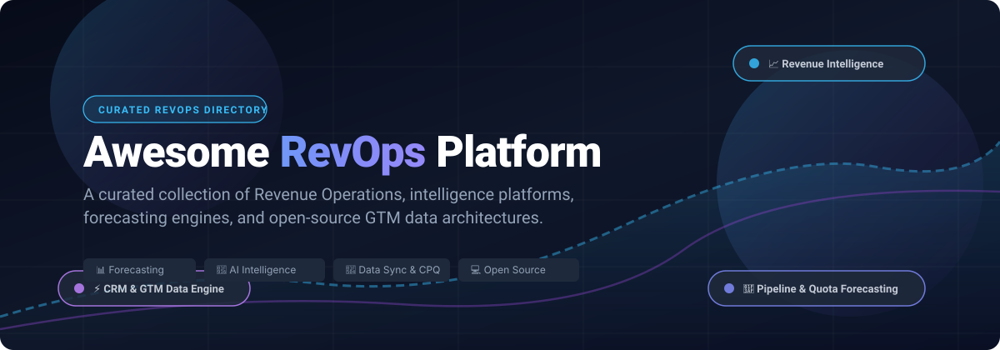

# 🚀 Awesome Revenue Operations (RevOps) Platform 📈

  
  
  
  
  

  A curated directory of top <strong>Revenue Operations (RevOps) platforms</strong>, revenue intelligence engines, pipeline forecasting tools, and sales enablement frameworks — spanning industry-standard SaaS platforms and modern open-source foundations.

  🌟 <strong>Star this repository if you find it helpful!</strong> 🌟

---

## 📋 Table of Contents 📑

- [🌐 Sector Overview & Market Dynamics](#-sector-overview--market-dynamics)
- [🟦 SaaS / Hosted Platforms](#-saas--hosted-platforms)
- [🟩 Open-Source Software](#-open-source-software)
- [📊 Comparison at a Glance](#-comparison-at-a-glance)
- [⭐ Star History](#-star-history)
- [💖 Support & Sponsorship](#-support--sponsorship)
- [🤝 Contributing](#-contributing)
- [📄 License](#-license)

---

## 🌐 Sector Overview & Market Dynamics 📊

The global Revenue Operations (RevOps) and revenue intelligence platform market was valued at approximately **$4.4B – $4.9B in 2024** and is projected to reach **$9.6B to over $14B by 2030**, compounding at an estimated **CAGR of ~16.5%** 🚀. The sector remains **moderately to highly fragmented** rather than a winner-take-all monopoly: while enterprise heavyweights (Salesforce, HubSpot, Clari, Gong) dominate conversation and pipeline intelligence for top-tier enterprises, an extensive ecosystem of point solutions, modular data synchronizers, AI agent automations, and self-hosted open-source CRM/pipeline tools addresses specialized RevOps niches.

---

## 🟦 SaaS / Hosted Platforms ☁️

Leading commercial cloud Revenue Operations platforms, sorted descending by company scale (valuation / annual recurring revenue) 🏢.

| Platform 🏷️ | Valuation / Revenue Scale 💰 | Starting Pricing 💳 | Free Tier / Trial Limit ⏳ | Key RevOps Capabilities ⚡ |
| :--- | :--- | :--- | :--- | :--- |
| **[Gong](https://www.gong.io)** 🎙️ | **~$4.5B – $7.25B Valuation** *(~$500M ARR run-rate)* | **~$100 – $120/user/mo** *(billed annually; base platform fee $5,000–$50,000/yr)* | **No free tier** *(Sales-assisted 14 to 30-day pilot for qualified enterprise teams)* | Conversation intelligence, deal execution, call/email recording, predictive revenue forecasting, and rep coaching. |
| **[Clari](https://www.clari.com)** 🔮 | **~$2.6B Valuation** *(~$150M – $180M ARR)* | **~$100 – $125/user/mo** *(approx. $1,200–$1,500/user/yr billed annually)* | **No free tier** *(No self-serve trial; custom POC available upon enterprise consultation)* | Enterprise RevOps standard for predictive sales forecasting, pipeline inspection, CRM data hygiene, and RevGPT/Copilot insights. |
| **[LeanData](https://www.leandata.com)** 🔀 | **~$100M – $250M Valuation** *(~$22M – $36M ARR)* | **~$39/user/mo** *(Standard Tier; annual contracts typically start at $25,000+/yr)* | **No free tier** *(No public free trial; live sandbox demos and guided assessments upon request)* | Enterprise lead-to-account matching, multi-touch attribution, automated lead routing, and pipeline handoff orchestration. |
| **[BoostUp.ai (Terret)](https://www.boostup.ai)** 🤖 | **~$100M – $250M Valuation** *(~$11M – $29M ARR)* | **~$51 – $79/user/mo** *(Mid-market tier billed annually)* | **No free tier** *(No self-serve free trial; guided custom POC provided upon sales request)* | AI-first revenue intelligence, risk scoring, buyer engagement tracking, and pipeline forecasting alternative to Clari. |
| **[Fullcast](https://www.fullcast.io)** 🗺️ | **~$100M – $250M Valuation** *(~$10M – $19M ARR)* | **Custom quote-based** *(Scaled by operational headcount; typically starts at $15,000+/yr)* | **No free tier** *(No self-serve free trial; interactive sandboxes and risk-free evaluations on request)* | End-to-end go-to-market territory design, sales capacity modeling, automated quota allocation, and policy enforcement. |
| **[Aviso](https://www.aviso.com)** 🧠 | **Private / Multi-Million Growth** *(~$33M – $37M ARR)* | **~$40 – $70/user/mo** *(Billed annually; entry packages typically start at $24,000/yr)* | **No free tier** *(No open trial; tailored multi-week guided POC available on enterprise request)* | Early pioneer of AI forecasting, deal guidance, predictive pipeline analytics, conversational AI, and relationship intelligence. |
| **[Syncari](https://www.syncari.com)** 🔄 | **Growth Stage** *(~$26.8M funded; ~$2M – $7M ARR)* | **~$995/month** *(Platform tier based on synchronized record volume)* | **30-day free trial** *(Syncari Test Drive sandbox with preloaded schemas and test connectors)* | Multi-directional RevOps data synchronization, automated deduplication, unified customer graphs, and cross-platform governance. |

---

## 🟩 Open-Source Software 💻

Self-hostable, community-driven RevOps engines, CRM backends, forecasting algorithms, and revenue intelligence pipelines. Repositories are sorted descending by GitHub stargazers ⭐.

| Project 🛠️ | GitHub_Stars ⭐ | Stack 🧰 | Primary RevOps Focus 🎯 | License 📜 |
| :--- | :---: | :--- | :--- | :--- |
| **[Twenty](https://github.com/twentyhq/twenty)** 🏛️ |  | TypeScript, NestJS, React, GraphQL, PostgreSQL | Modern open-source CRM alternative to Salesforce; custom objects, multi-pipeline tracking, and extensible RevOps APIs. | AGPL-3.0 |
| **[Airbyte](https://github.com/airbytehq/airbyte)** 🌊 |  | Java, Python, React, Docker | Universal ELT data integration sync for unifying CRM (Salesforce/HubSpot), billing (Stripe), and marketing data into data warehouses. | MIT / Elastic-2.0 |
| **[Eigent](https://github.com/eigent-ai/eigent)** 🤖 |  | Python, Multi-Agent Framework, Local LLMs | Autonomous AI agent desktop for RevOps teams: automated CRM hygiene audits, QBR deck generation, and handoff summaries. | Open Source |
| **[SuiteCRM](https://github.com/salesagility/SuiteCRM)** 💼 |  | PHP, Symfony, JavaScript, MariaDB | Full-featured enterprise open-source CRM with pipeline workflows, quoting (CPQ), lead management, and contract tracking. | AGPL-3.0 |
| **[EspoCRM](https://github.com/espocrm/espocrm)** ⚡ |  | PHP, Backbone.js, MySQL | Lightweight open-source sales operations system with sales pipeline kanban, BPMN flow automation, and sales analytics. | AGPL-3.0 |
| **[Horilla CRM](https://github.com/horilla/horilla-crm)** 🦍 |  | Python, Django, PostgreSQL, Celery | Open-source CRM platform covering deals, accounts, lead scoring, campaign attribution, and built-in forecasting tools. | LGPL-2.1+ |
| **[AI RevOps Intelligence Engine](https://github.com/kevorklepedjian1/ai-revops-intelligence-engine)** 🔬 |  | n8n, OpenAI, Gong/HubSpot API, Supabase | Automated revenue operations engine analyzing sales call recordings to detect churn risk, deal roadblocks, and push alerts. | MIT |
| **[FlowPilot AI Revenue Ops](https://github.com/slowsliwa-maxim/flowpilot-ai-revenue-ops)** 🧭 |  | Python, FastAPI, Webhooks, LLM APIs | AI-assisted revenue operations backend for lead qualification, pipeline velocity diagnostics, and executive metrics reporting. | MIT |
| **[pipeline-diff](https://github.com/goran-revops/pipeline-diff)** 🔍 |  | Python, HubSpot & Salesforce SDKs, CLI | CLI and dashboard utility for pipeline change analysis; inspects deal movements between forecast categories over time. | MIT |
| **[b2b-revenue-forecasting](https://github.com/shreyasrkarwa/Analytics/tree/main/hierarchical_sales_forecasting)** 📐 |  | Python, pandas, NetworkX, DAGs | Programmatic B2B sales quota cascading and commit reconciliation engine; models organizational hierarchies and adjusts bias. | MIT |
| **[Revenue Ops AI Assistant](https://github.com/mizcausevic-dev/revenue-ops-ai-assistant)** 💡 |  | TypeScript, Node.js, PostgreSQL, OpenAI | Reference backend for revenue intelligence: exposes bounded AI endpoints for deal risk briefings and GTM operator summaries. | MIT |
| **[Odden CRM Sales](https://github.com/getodden/crm)** 🎯 |  | PHP, Laravel, Filament | Modular deal acceleration engine for RevOps: stage-gate enforcement, deal rotting scores, CPQ, and weighted forecasting. | MIT |
| **[AINative GTM MCP](https://github.com/AINative-Studio/ainative-gtm-mcp)** 🔌 |  | TypeScript, Model Context Protocol (MCP) | Model Context Protocol server exposing 57 RevOps and marketing automation tools directly to AI agents (Claude, Cursor). | MIT |

---

## 📊 Comparison at a Glance ⚖️

| Software 🏷️ | Model 📦 | Core RevOps Focus 🎯 | Primary Strength 🚀 | Self-Hostable 🏠 | Best For 👥 |
| :--- | :--- | :--- | :--- | :---: | :--- |
| **Gong** 🎙️ | SaaS | Conversation & Deal Intelligence | Call/email analysis & deal progression | ❌ | High-velocity B2B sales teams |
| **Clari** 🔮 | SaaS | Revenue Cadence & Forecasting | Predictive AI forecasting & pipeline inspection | ❌ | Enterprise RevOps & executive planning |
| **LeanData** 🔀 | SaaS | Lead Routing & Attribution | Complex Salesforce lead-to-account matching | ❌ | Inbound-heavy enterprise revenue teams |
| **BoostUp.ai** 🤖 | SaaS | Predictive Pipeline Analytics | Deal health scoring & digital engagement tracking | ❌ | Mid-market revenue intelligence |
| **Fullcast** 🗺️ | SaaS | Territory Planning & Policy | Real-time continuous territory management | ❌ | Complex sales org design & carve-outs |
| **Aviso** 🧠 | SaaS | AI Forecasting & Deal Guidance | Multi-layered AI predictive algorithms | ❌ | Advanced AI forecasting at scale |
| **Syncari** 🔄 | SaaS | Multi-System Data Synchronization | State synchronization & data governance | ❌ | Unifying fragmented CRM, ERP & billing stacks |
| **Twenty** 🏛️ | Open Source | Modern CRM Foundation | Highly extensible, modern developer-first stack | ✅ | Teams wanting a self-hosted Salesforce alternative |
| **Airbyte** 🌊 | Open Source | GTM / RevOps Data Pipelines | 300+ connectors for sales and billing data | ✅ | Data-driven RevOps & analytical warehousing |
| **Eigent** 🤖 | Open Source | RevOps Agentic Automation | AI desktop agent for CRM hygiene & QBR reports | ✅ | Automated operational audits & summaries |
| **SuiteCRM** 💼 | Open Source | Enterprise CRM & Quoting (CPQ) | Battle-tested workflows & module customization | ✅ | Traditional enterprise sales processes |
| **EspoCRM** ⚡ | Open Source | Lean Sales Management | Fast UI, Kanban pipelines, and BPMN flows | ✅ | SMBs seeking nimble sales operations |
| **Horilla CRM** 🦍 | Open Source | Full CRM & Pipeline Forecasting | Clean Django codebase & integrated forecasting | ✅ | Python/Django development environments |
| **AI RevOps Engine** 🔬 | Open Source | Call & Deal Risk Automation | n8n + Gong/HubSpot automated deal triaging | ✅ | Automated risk alerts into Slack & CRM |
| **pipeline-diff** 🔍 | Open Source | Pipeline Change Tracking | Local CLI snapshotting of deal stage shifts | ✅ | Answering "what changed in pipeline this week" |
| **b2b-revenue-forecasting** 📐 | Open Source | Quota Cascading & Bias Math | DAG-based organizational quota modeling | ✅ | Programmatic finance & quota calculation |
| **Odden CRM Sales** 🎯 | Open Source | Deal Health & Laravel Engine | Embeddable deal rotting and CPQ engine | ✅ | Laravel & Filament web applications |

---

## 📈 Star History

---

## 💖 Support & Sponsorship ☕

Thank you so much for exploring and using **Awesome Revenue Operations (RevOps) Platform**! 🙌

If this project helped you discover valuable tools, saved you hours of research, or added value to your RevOps stack, please consider supporting its ongoing curation and maintenance:

- ⭐ **Star this repository** to help others discover it!
- 🍴 **Fork and share** it with your fellow RevOps, SalesOps, and engineering teammates.
- ☕ **Buy a coffee / Sponsor**: Support further development via the [GitHub Sponsor Dashboard](https://github.com/sponsors/ishaddutta2007).

Your support keeps this curated ecosystem fresh, active, and comprehensive! ❤️

---

## 🤝 Contributing 💡

Contributions are welcome! If you know of an open-source Revenue Operations tool, revenue forecasting library, or pipeline intelligence platform that should be included:

1. 🍴 Fork this repository.
2. ✍️ Add the tool to the appropriate section in descending order.
3. 🧪 Ensure the project is actively maintained with a permissive or standard open-source license.
4. 🚀 Submit a pull request with a brief summary of why it belongs in the list.

---

## 📄 License ⚖️

This collection is distributed under the [Creative Commons Zero v1.0 Universal](LICENSE) (CC0 1.0) Public Domain dedication. Listed software projects and trademarks belong to their respective copyright owners.

---

  ⭐ <strong>If you find this RevOps directory useful, consider giving it a star!</strong> ⭐

